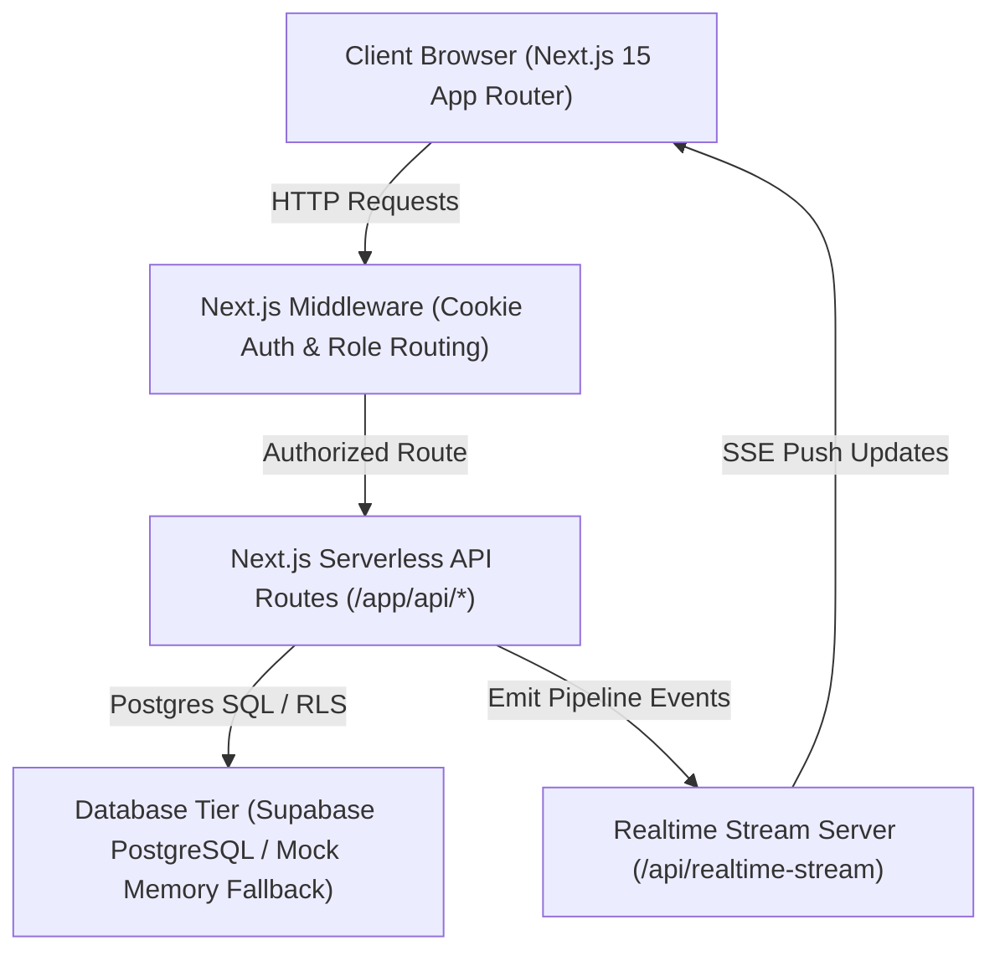
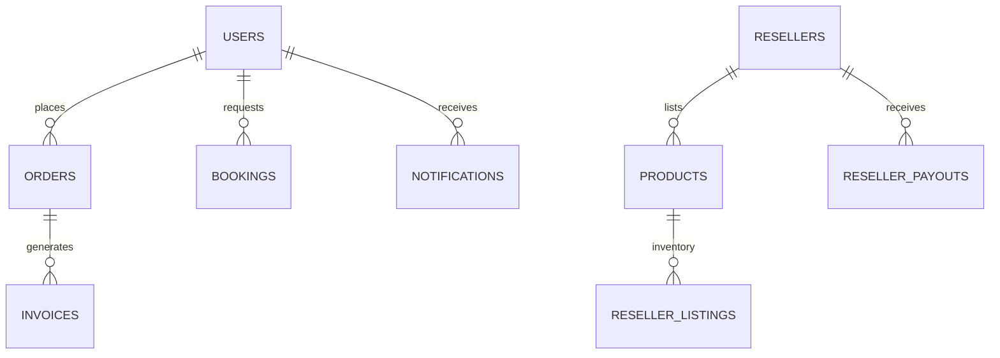

# NEX LAPTECH — COMPLETE WEBSITE DOCUMENTATION

**Document Revision Date:** October 9, 2026  
**Project Version:** 1.0.0  
**Stack:** Next.js 15.0.3, React 19.0.0, TypeScript 5.6.3, Tailwind CSS 3.4.14, Supabase (PostgreSQL)

---

## 📋 Table of Contents

1. [Executive Summary & Business Overview](#1-executive-summary--business-overview)
2. [Target User Roles & Key Use Cases](#2-target-user-roles--key-use-cases)
3. [System Architecture & Data Flows](#3-system-architecture--data-flows)
4. [Master Navigation & Route Inventory](#4-master-navigation--route-inventory)
5. [Frontend Design System & UI/UX Tokens](#5-frontend-design-system--uiux-tokens)
6. [Backend Services & API Architecture](#6-backend-services--api-architecture)
7. [Database Schema & Entity-Relationship Architecture](#7-database-schema--entity-relationship-architecture)
8. [Security, Auth & Role Isolation](#8-security-auth--role-isolation)
9. [E-Commerce & Service Operations](#9-e-commerce--service-operations)
10. [Reseller Marketplace & Commission Engine](#10-reseller-marketplace--commission-engine)
11. [Integrations & External Services](#11-integrations--external-services)
12. [Verification, Quality Assurance & Test Results](#12-verification-quality-assurance--test-results)
13. [Deployment, Hosting & Production Operations](#13-deployment-hosting--production-operations)
14. [Legal, Compliance & Launch Readiness](#14-legal-compliance--launch-readiness)
15. [Developer Handover & Onboarding Guide](#15-developer-handover--onboarding-guide)
16. [Supporting Documentation Inventory](#16-supporting-documentation-inventory)
17. [Glossary of Terms](#17-glossary-of-terms)

---

## 1. Executive Summary & Business Overview

**Nex LapTech** is a unified, full-stack B2C & B2B e-commerce platform and IT services portal. It connects retail customers, multi-vendor reseller partners, and internal company administrators under a single web application built with **Next.js 15 (App Router)** and **Supabase (PostgreSQL)**.

### Core Business Pillars
1. **Direct E-Commerce Storefront:** Retail catalog for laptops, desktop computers, components, peripherals, and custom PC builds.
2. **Doorstep IT & Service Bookings:** Booking engine for laptop repairs, desktop diagnostics, network setup, and custom assembly services.
3. **Multi-Vendor Reseller Marketplace:** Partner portal allowing authorized resellers to list products, manage inventory, track category commissions, and request payouts.
4. **EduTech & Skill Programs:** Training courses and internship applications with automated completion certificate generation and verification.
5. **E-Warranty & Product Authentication:** Digital warranty tracking and serial number verification system.

---

## 2. Target User Roles & Key Use Cases

| User Role | Access Route | Key Functions & Responsibilities |
| :--- | :--- | :--- |
| **Retail Customer** | `/`, `/customer/*`, `/products` | Browse catalog, filter items, add to cart/wishlist, checkout, track orders, book IT services, message support/sellers, request certificates/warranties. |
| **Reseller Partner** | `/reseller/*` | Submit product listings for approval, manage stock, view category commission breakdowns, view orders, request payouts, message customers. |
| **Platform Admin** | `/admin/*` | Full system control: approve reseller products, manage billing/invoices, audit CRM leads, configure global settings, override prices, release payouts. |

---

## 3. System Architecture & Data Flows

The application follows a **Hybrid Server-Side & Serverless Architecture**:

### Key Data Flows
1. **Checkout to Invoice:** Customer places order ➔ Price verified server-side ➔ Stock decremented ➔ Invoice generated (`NEX-YYYY-XXXX`) ➔ Activity logged.
2. **Reseller Listing to Sale:** Reseller submits item ➔ Admin receives `product_approval` alert ➔ Admin approves ➔ Item appears in store ➔ Sale triggers automated 3–5% commission split.
3. **Service Inquiry Pipeline:** Customer submits repair request ➔ Admin or assigned Reseller receives notification ➔ Status updated ➔ Real-time alert pushed to Customer.

---

## 4. Master Navigation & Route Inventory

For complete details on all 40+ routes, refer to [`docs/WEBSITE_FEATURE_INVENTORY.md`](file:///e:/ne/nexbyte/docs/WEBSITE_FEATURE_INVENTORY.md).

---

## 5. Frontend Design System & UI/UX Tokens

The customer portal adheres to a **Pure White Light Theme** (`#FFFFFF` / `#F8FAFC`) with modern display typography:
* **Headings & Display Numbers:** `Plus Jakarta Sans` (`font-display`, weights 600, 700, 800).
* **Body Text & Interactive UI:** `Inter` (`font-sans`, weights 400, 500, 600).
* **Primary Brand Action:** Electric Blue (`#2563EB`) with soft blue selections (`#EFF6FF`).
* **Borders & Cards:** Fine neutral slate borders (`#E2E8F0` / `#CBD5E1`).
* **Admin Theme:** Distinct high-contrast dark navy theme (`#080D1B`), strictly segregated from customer components.

---

## 6. Backend Services & API Architecture

For exhaustive documentation of all 26+ API endpoints, view [`docs/API_AND_DATABASE_DOCUMENTATION.md`](file:///e:/ne/nexbyte/docs/API_AND_DATABASE_DOCUMENTATION.md).

---

## 7. Database Schema & Entity-Relationship Architecture

The schema contains 15 primary database tables managed via Supabase PostgreSQL or local memory fallback:

---

## 8. Security, Auth & Role Isolation

* **Middleware Session Verification (`middleware.ts`):** Checks `nexbyte_admin_session`, `nexbyte_reseller_session`, and `nexbyte_customer_session` HTTP cookies.
* **Server-Side Price Authority:** Cart prices sent from client browsers are ignored; prices are recalculated from authoritative database records upon POST to `/api/checkout`.
* **Row-Level Security (RLS):** Supabase database policies isolate customer notifications and orders by `auth.uid()`.

---

## 9. E-Commerce & Service Operations

* **GST Invoicing:** Automated calculation of GST rates (18% IT equipment standard), sequential invoice numbering, and client-side PDF export via `@react-pdf/renderer`.
* **Atomic Stock Guarding:** Decrements stock atomically upon order placement and restores stock upon order cancellation, rejecting oversell attempts.

---

## 10. Reseller Marketplace & Commission Engine

* **Commission Structure:** 4% for laptops, 3% for storage/RAM components, 5% default for general accessories.
* **Payout Workflow:** Payouts computed as `Net Earnings - Paid Payouts`. Payouts released by Admin with banking reference tracking.

---

## 11. Integrations & External Services

| Service | Purpose | Status |
| :--- | :--- | :--- |
| **Supabase** | PostgreSQL Database, Auth & RLS | Configured & Live |
| **Next.js API Engine** | Serverless Backend Endpoints | Implemented & Verified |
| **@react-pdf/renderer** | Invoice & Certificate PDF Generation | Active |
| **XLSX** | Data Exports (Orders, Invoices) | Active |

---

## 12. Verification, Quality Assurance & Test Results

Detailed evidence can be found in [`docs/TESTING_AND_VERIFICATION_REPORT.md`](file:///e:/ne/nexbyte/docs/TESTING_AND_VERIFICATION_REPORT.md).

* **TypeScript Compilation (`npx tsc --noEmit`):** PASS (0 errors).
* **ESLint Static Analysis (`npm run lint`):** PASS (0 errors).
* **Pipeline Audit Suite (`test_pipeline_audit.ts`):** 10 / 10 PASS.
* **Production QA & Security Suite (`test_phase8_production_qa.ts`):** 20 / 20 PASS.

---

## 13. Deployment, Hosting & Production Operations

Refer to [`docs/DEPLOYMENT_AND_ENVIRONMENT_GUIDE.md`](file:///e:/ne/nexbyte/docs/DEPLOYMENT_AND_ENVIRONMENT_GUIDE.md) for step-by-step launch procedures.

---

## 14. Legal, Compliance & Launch Readiness

Detailed compliance review is documented in `docs/LEGAL_COMPLIANCE_REVIEW.md` and `docs/PRODUCTION_LAUNCH_CHECKLIST.md`.

---

## 15. Developer Handover & Onboarding Guide

* **Local Server Start:** `npm run dev` (Runs Next.js App Router on `http://localhost:3000`).
* **Main Configuration Files:**
  * Global Design Tokens: `app/globals.css`
  * Tailwind Config: `tailwind.config.ts`
  * Database & Storage Helper: `lib/dbHelper.ts`
  * Auth & Role Protection: `lib/auth.ts` and `middleware.ts`

---

## 16. Supporting Documentation Inventory

This master documentation links to the following specialized guides:
1. 📄 [`WEBSITE_FEATURE_INVENTORY.md`](file:///e:/ne/nexbyte/docs/WEBSITE_FEATURE_INVENTORY.md)
2. 📄 [`API_AND_DATABASE_DOCUMENTATION.md`](file:///e:/ne/nexbyte/docs/API_AND_DATABASE_DOCUMENTATION.md)
3. 📄 [`TESTING_AND_VERIFICATION_REPORT.md`](file:///e:/ne/nexbyte/docs/TESTING_AND_VERIFICATION_REPORT.md)
4. 📄 [`DEPLOYMENT_AND_ENVIRONMENT_GUIDE.md`](file:///e:/ne/nexbyte/docs/DEPLOYMENT_AND_ENVIRONMENT_GUIDE.md)
5. 📄 [`PENDING_WORK_AND_ROADMAP.md`](file:///e:/ne/nexbyte/docs/PENDING_WORK_AND_ROADMAP.md)

---

## 17. Glossary of Terms

* **AIDA Pattern:** Attention, Interest, Desire, Action framework applied to homepage hero sections.
* **RLS:** Row Level Security in Supabase PostgreSQL restricting data access by authenticated user ID.
* **SSE:** Server-Sent Events used for real-time notification streaming.
