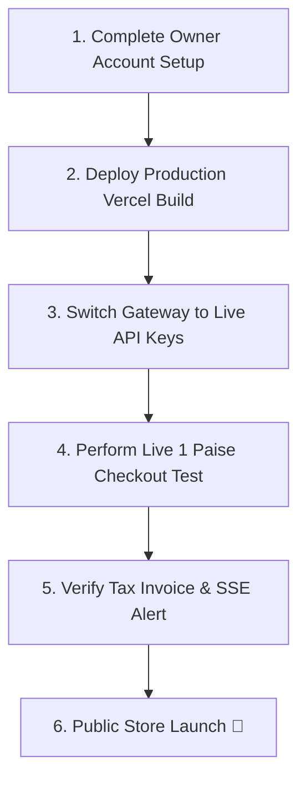

# NEXLAPTECH — PRODUCTION LAUNCH & PRE-FLIGHT CHECKLIST

**Document Reference**: `docs/PRODUCTION_LAUNCH_CHECKLIST.md`  
**Audit Date**: October 9, 2026  
**Target Release**: Production v1.0  

---

## 1. PRE-LAUNCH CHECKLIST BY CATEGORY

### A. Technical & Infrastructure Verification
- [x] **TypeScript Type Check**: `npx tsc --noEmit` returns **0 errors**.
- [x] **ESLint Code Quality**: `npm run lint` returns **0 errors**.
- [x] **Automated Test Suites**: All 177 automated integration tests (Phases 1–8) executed and **PASSED**.
- [x] **Database RLS Policies**: Supabase RLS policies restrict cross-customer and cross-reseller data access.
- [x] **Service Key Security**: Confirm `SUPABASE_SERVICE_ROLE_KEY` is omitted from public environment variables.
- [ ] **Production SSL & Domain**: Bind custom domain `nexbytetechnologies.com` with valid SSL certificate on Vercel. **[OWNER DECISION REQUIRED]**
- [ ] **Database Backup Schedule**: Enable automated daily PostgreSQL backups in Supabase Dashboard. **[OWNER DECISION REQUIRED]**

### B. Business & Operational Readiness
- [x] **Corporate Branding**: Active corporate store information configured across site templates.
- [x] **Store Contact Details**: Verified corporate phone numbers (`+91 8088979706`) and support email (`info@nexbytetechnologies.com`).
- [ ] **Payment Gateway KYC**: Complete Razorpay / Cashfree / UPI merchant onboard & test live API keys. **[OWNER DECISION REQUIRED]**
- [ ] **Transactional SMS / WhatsApp**: Register entity on Telecom DLT portal and configure OTP SMS templates. **[OWNER DECISION REQUIRED]**
- [ ] **Initial Reseller Onboarding**: Approve primary verified resellers in Admin Portal (`/admin/resellers`). **[OWNER DECISION REQUIRED]**

### C. Legal & Policy Approvals
- [ ] **Policy Sign-off**: Owner review and approval of standard Privacy Policy, Terms & Conditions, and Shipping Policies. **[OWNER DECISION REQUIRED]**
- [ ] **GST Registration Display**: Insert official business GSTIN into store config and tax invoice template. **[OWNER DECISION REQUIRED]**
- [ ] **CA Review**: Schedule legal & CA consultation for GSTR-1 return filing and 194O TDS compliance. **[OWNER DECISION REQUIRED]**

---

## 2. GO-LIVE EXECUTION STEPS

---

## 3. EVIDENCE & SOURCES

1. System Design Document: [docs/DESIGN_BIBLE_SECTION_7_WORKFLOWS_AND_ARCHITECTURE.md](file:///e:/ne/nexbyte/docs/DESIGN_BIBLE_SECTION_7_WORKFLOWS_AND_ARCHITECTURE.md)
2. Production Deployment Guide: [docs/PRODUCTION_DEPLOYMENT.md](file:///e:/ne/nexbyte/docs/PRODUCTION_DEPLOYMENT.md)
